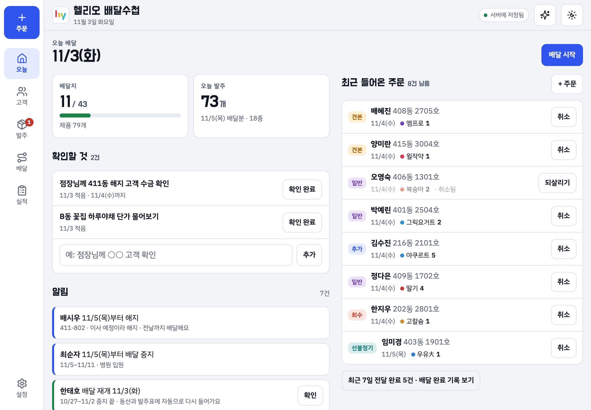
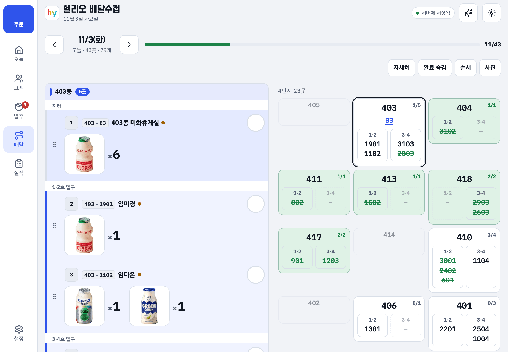
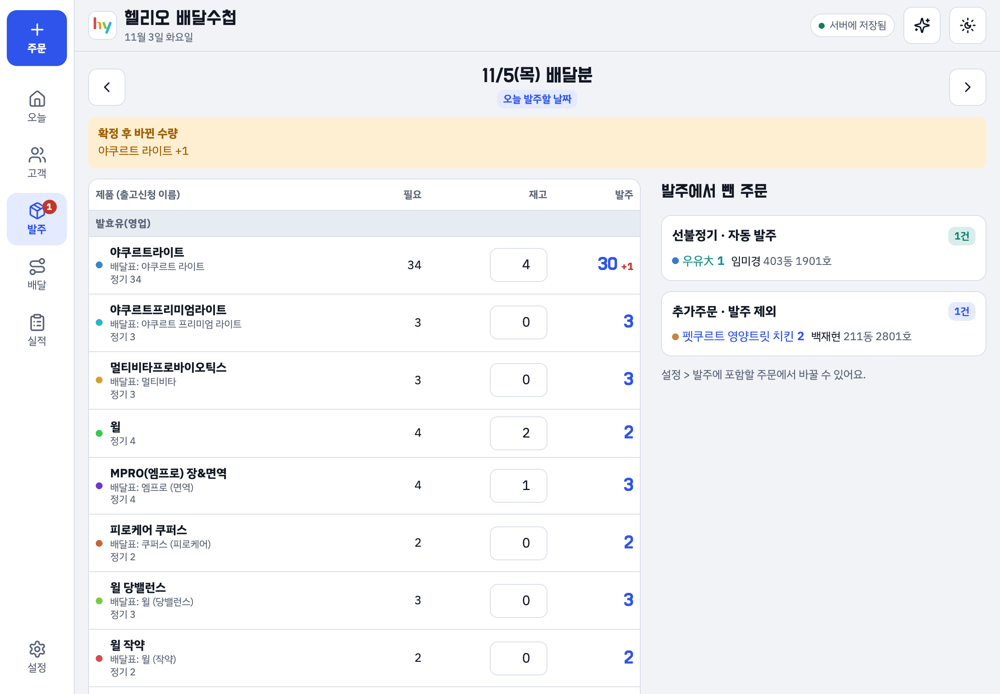
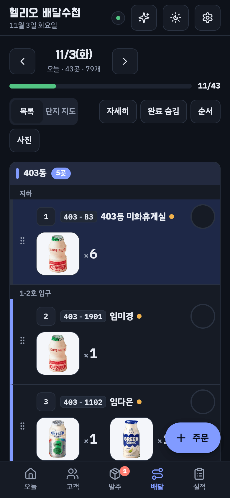

# Helio Delivery Notebook · 헬리오 배달수첩

I work as an hy (Korea Yakult) delivery manager in Songpa Helio City, Seoul. I deliver to about 65 regular customers across two apartment complexes, plus shops, a senior center, a community office, and the cleaning and security staff rooms. This is the tool I built to run that route. I use it every working day on my iPad and iPhone.



> All screenshots use made-up customers. Real customer data is never in this repository (see [Privacy](#privacy)).

## The problem

My day was split across several places that do not talk to each other:

- **hy's customer app** has each customer's regular (subscription) order.
- **KakaoTalk notifications** bring in one-time orders: Fredit online orders, free samples, prepaid subscription deliveries, return pickups.
- **The ordering app** needs the stock request **two business days ahead** (T-2). A Monday mistake shows up on Wednesday.
- **A paper sheet** was the route list. Pauses ("we travel next week"), quantity changes for just one day, building entrances, and paper bills were all kept in my head.

When something slipped, a customer got the wrong item, or I ordered too much or too little stock.

## What it does

| Area | What it does |
|---|---|
| **Customers** | Regular items per weekday, every-other-week items, payment method, notes. Status is active, waiting, paused, cancelled, or moved. Cancelled customers stay on the list because I still collect payment from them. |
| **Pauses** | A date range or only certain weekdays. Delivery comes back by itself when the pause ends, and the home screen warns me before it starts and ends. |
| **T-2 ordering sheet** | Adds up demand for the order date. Stock defaults to 0. Rows are grouped and named like in hy's ordering app, so I can copy the list straight into it. |
| **Order types** | Follows hy's own categories: postpaid regular, prepaid regular, general (Fredit), sample, my own extra orders, and return pickup. Only the types I buy myself go into the ordering sheet. Samples become a "pick up at the branch" alert. |
| **Route** | Sorted by my building order, then entrance (1·2호 / 3·4호), then floor. I can drag to reorder, and stops in the same building are grouped. There is a complex map that shows each building's unit numbers by entrance (tap to jump to it), check-off with timestamps, and export of the finished route as an image. |
| **One-day changes** | "Only this Monday, 2 instead of 5": a per-day override that does not touch the regular contract. |
| **Holidays** | A full day off, or a public holiday where apartments still get delivery and shops and offices are skipped. |
| **Change log** | Every change records two dates: when I entered it, and the date it applies to. Undo is available right after each change. |
| **Monthly performance** | Each finished day is frozen as a snapshot, so later edits do not rewrite past months. If a change is back-dated (for example "cancelled since the 7th"), only the affected days are recomputed. |
| **Daily completion records** | When every stop is checked, the day is saved with the time and item counts. I can look these up later. |
| **Paper bills** | A list of customers who get a paper bill this month. A bill icon shows next to their unit on the route until I tap it. Customers with no upcoming delivery show up on the home screen. |
| **Reminders** | A "to check" list on the home screen, like "ask the branch manager about this customer". |
| **AI assistant** | I can type or paste a KakaoTalk screenshot, for example "Kim at 411-1501 pauses next week". It changes the data through tool calls (add order, pause, set status…), and each AI turn can be undone. |

| Route (iPad) | Ordering sheet | iPhone, dark mode |
|---|---|---|
|  |  |  |

## How it is built

Version 2 keeps every feature and rule of the original and moves it onto a normal project setup (see [docs/CHANGELOG.md](docs/CHANGELOG.md)).

- **An installable web app (PWA) that works without internet.** Added to the iPad and iPhone Home Screen from Safari. The app, the product photos and the fonts are stored on the device, so it opens and works in basements and stairwells with no signal.
- **Data in Firebase, a copy on the device.** Every change is saved on the device first and sent to the server as soon as there is a connection, even if the app was closed in between. The iPad and the iPhone see each other's changes live. Records are stored one per customer, order and day, so two devices editing different things never overwrite each other. Nothing is pruned: past orders, logs and monthly performance stay on the server, and the server is backed up every day.
- **Google sign-in with approval.** A new account waits until an approved user lets it in (Settings > 사용자).
- **Product photos on the route.** Each stop shows its products as big photos with the count ("[photo] ×4"), so items are recognised at a glance while walking. The order form uses photos to pick products; lists and records keep names, which are easier to read there.
- **AI assistant through a small server function.** The AI key stays on the server, and 설정 > AI chooses between fast, balanced and most accurate. The assistant gets the same context as before (today, the products, every customer with regular items and pauses, the next two weeks of orders) plus tools that change the data exactly like the buttons do, and each AI turn can be undone. The conversation is shared between iPad and iPhone.
- **Stack:** Vite + React (JavaScript), shadcn/ui, react-icons, Firebase (Auth, Firestore, Cloud Functions, Hosting). The original logic lives in `src/domain/` almost line for line. Developer notes are in [CLAUDE.md](CLAUDE.md).
- **Data model** (simplified, unchanged from version 1):
  ```
  customer  { id, name, loc{building, unit, type}, regular[{productId, qty, days[], every, anchor}],
              pauses[{from, to, days[]}], status, endDate, payment, holidayOff, … }
  order     { id, type, customerId | name+loc, date, items[{productId, qty}], noBuy, status, note }
  day       { ov{custId: {items, skip}}, seq[], done{stopKey: time}, completedAt }
  perf      { days{date: {s{stopKey: "pid*qty*type;…"}}} }   // frozen monthly snapshot
  ```
- **Route order** = building rank → entrance group → floor (high to low), then my saved base order, then that day's drag changes.
- **Product names** keep two names, the short one on my delivery sheet and the exact name in hy's ordering app, so the ordering list can be copied as-is. Items not in the catalog (pet products, gift sets) can be typed in by name. They go on the route but never into the ordering sheet.

## Privacy

- This repository contains **only code**. No names, phone numbers, addresses, orders, or logs.
- Real data lives in Firebase behind security rules: only signed-in, approved accounts can read or write it.
- `.gitignore` blocks data exports (`*.json` backups, `*.csv`, `*.xlsx`, phone screenshots), local keys (`.env.local`) and the source photo folders.
- Screenshots in `docs/` use made-up demo customers (Settings > 데이터 > 예시 데이터 넣기).

## Running it

- **Use it:** open https://hy-delivery-notebook.web.app in Safari → Share → **Add to Home Screen**, then sign in with Google once.
- **Develop:** `npm install`, copy `.env.example` to `.env.local`, then `npm run dev`. `npm run emulators` + `npm run dev:emu` run everything locally against the Firebase emulators. Details in [CLAUDE.md](CLAUDE.md).

## How I made it

The idea, the requirements and the testing are mine. I wrote down what went wrong on the route and turned each problem into a feature request: entrances, back-dated cancellations, holidays where only shops close, bills that were marked as given when they were not. Then I tested every version on the next morning's deliveries.

The code was written together with Claude (Anthropic) as an AI pair programmer. I described the problem and the rules of my job. Claude proposed and wrote the implementation. I checked it against real deliveries and asked for fixes.

The commit history shows how it grew, one real problem at a time. The full list is in [docs/CHANGELOG.md](docs/CHANGELOG.md).

---

### 한국어 요약

송파 헬리오시티에서 hy 배달 매니저로 일하면서 매일 쓰는 배달 관리 앱이에요. 정기 고객 관리, 2영업일 전(T-2) 발주표, 입구·층 순서로 정렬되는 배달 동선, 알림톡 주문 입력(일반·견본·선불정기·추가·회수), 중지와 자동 재개, 공휴일, 변경 기록, 월별 실적, 종이 청구서 전달 표시, AI 도우미가 한 화면에 있어요. 제품은 이름 대신 사진과 개수로 보여요. iPad·iPhone 홈 화면에 추가해서 인터넷이 없어도 쓰고, 연결되면 서버(Firebase)에 자동으로 저장돼요. 이 저장소에는 코드만 있고 고객 정보는 없어요.
